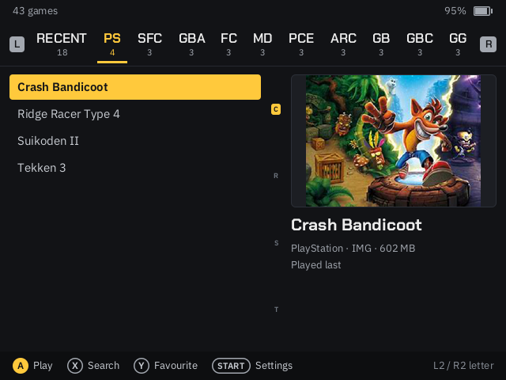
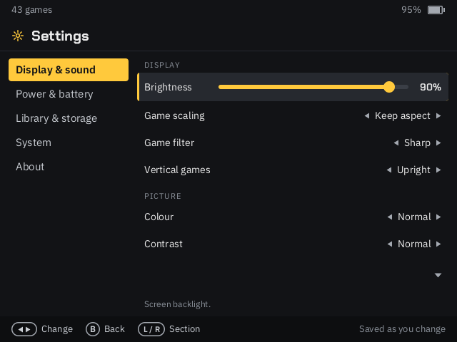

# gb350-linux

Replacement software for the GB350 v1.22 handheld (HiChip HC1600A: MIPS
74Kc at 1188 MHz for Linux, a second MIPS 24KE core, 256 MiB): mainline
Linux 7.2 with drivers for the board, a Rust userspace (agent, launcher,
emulator frontend) and Rust firmware for the second core. The stock
bootloader in SPI NOR is used as it is.

<p>


</p>

## Features

Compared with the stock firmware:

- **A current kernel.** Mainline Linux 7.2 with drivers written for the
  board (display, 2D engine, sound, buttons, battery, USB) instead of the
  vendor's Linux 4.4.
- **Faster PlayStation.** PCSX-ReARMed with the lightrec recompiler at
  normal accuracy settings (stock used pcsx4all with aggressive speed
  hacks), and **both CPU cores drawing**: the second core renders part of
  each frame. Heavy 3D scenes that took 17 ms a frame on one core take
  about 15 ms, inside the 16.7 ms of a 60 fps frame.
- **Smooth video.** Each game runs at its own frame rate: the panel switches
  to the nearest refresh rate (50 to 75 Hz) and the display paces
  emulation, with the sound resampled to match, so no frames are dropped or
  shown twice.
- **Better picture.** Keep aspect, integer or stretched scaling, done by the
  display hardware; smooth or sharp filtering; colour, contrast and
  sharpness controls; vertical arcade and WonderSwan games turned upright by
  the 2D engine, or played with the console turned.
- **A quicker launcher.** Up 46 ms after it starts. One tab per system plus
  recently played and favourites, game pictures, search with an on-screen
  keyboard, jump by letter. Reads the stock card's game lists and pictures.
- **In-game menu.** Hold Select + Start: save and load states (4 slots per
  game), reset, volume, brightness, scaling, filter, quit. Saves are written
  every 30 s and on exit; a frozen game can still be left, with its save
  kept.
- **Games over USB.** Settings -> Connect to computer turns the console into
  a USB drive for copying games, without taking the card out.
- **Power and sound handled properly.** The second core scans the buttons,
  watches the battery and the power button and drives the speaker:
  headphones switch it off, and volume 0 really is silent.
- **11 emulators.** PlayStation, Super Famicom, Game Boy Advance, Famicom,
  Mega Drive / Master System / Game Gear, PC Engine, Game Boy (Color), Neo
  Geo Pocket (Color), WonderSwan (Color), Atari 2600 and arcade.
- **Easy to install and undo.** The installer page backs up the stock system
  on the card; the bootloader in the console's flash is never touched.

| Path | What |
|---|---|
| `kernel/` | Drivers, device tree, config and patches for mainline Linux |
| `avp/syscore` | Second-core firmware: buttons, power, battery, card, speaker, PS1 drawing |
| `crates/agent` | PID 1: system setup, console, USB control channel, power-off, USB storage mode, runs the launcher |
| `crates/launcher` | The game launcher |
| `crates/retro` | libretro frontend with one emulator core linked in, in-game menu |
| `crates/ui`, `crates/kms`, `crates/pcm`, `crates/corelink`, `crates/proto` | Drawing and text, display (DRM/KMS), sound (ALSA), the second-core link, the USB protocol |
| `cores/` | Patches and helpers for the emulator cores |

## Build

Needs Docker, rustup and curl. The Rust toolchain is pinned in
`rust-toolchain.toml`; zig (C compiler, musl, linker for the device) is
downloaded by `scripts/zig.sh`; the kernel source and BusyBox by
`scripts/build-kernel.sh` (all checked against pinned hashes).

```sh
scripts/build-cores.sh          # emulator cores -> out/cores/
scripts/build-ps1gpu.sh         # PS1 rasteriser for the second core -> out/ps1gpu/
avp/syscore/build.sh            # second-core firmware -> out/avp/
scripts/build-kernel.sh         # kernel + DT + modules (the agent in its initramfs) -> out/kernel/
cargo build -p gb350-launcher --release --target mipsel-unknown-linux-musl -Z build-std=std,panic_abort
scripts/build-emulators.sh      # one emulator per core -> out/emulators/
scripts/make-sdcard.sh          # the card's files -> out/sdcard/
```

Copy `out/sdcard/` to an exFAT card (MBR, one partition). Games go in one
folder per system at the card root (`PS/`, `SFC/`, `GBA/`, ...).

## Installing a release

https://csnewman.github.io/gb350-linux/ installs the latest release on a
GB350 card from Chrome or Edge on a computer (`web/index.html`). It moves
the card's current system into `backup/stock/` (the original firmware, kept
for good) or `backup/previous/` (the last GB350 Linux), writes and checks
the new files and creates the game folders. Releases are published there by
CI when a `v*` tag is pushed (`scripts/make-site.sh`).

## Licence

MIT (`LICENSE`), except `kernel/` (GPL-2.0, as Linux) and `cores/` (the
licences of the cores they patch or build on; PCSX-ReARMed is GPL-2.0).
The emulator binaries and the second-core firmware link GPL code.
